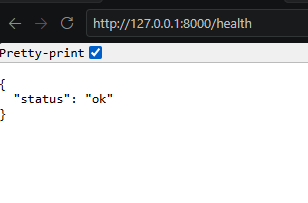
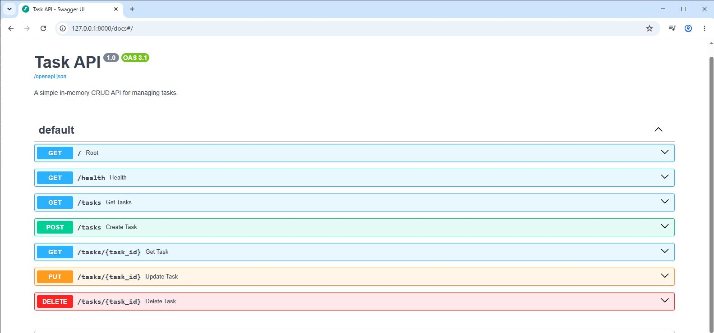

# Task API — FlyRank Internship Week 2

A simple REST API built with **Python and FastAPI** to manage a to-do list. The API supports creating, reading, updating, and deleting tasks. Task data is stored in memory, so no database is required.

## Features

- Create a new task.
- Retrieve all tasks or a task by ID.
- Update a task's title or completion status.
- Delete a task.
- Validate task input and return appropriate HTTP status codes.
- Interactive API documentation using Swagger UI.

## Technologies Used

- Python 3.13
- FastAPI
- Uvicorn
- Swagger UI
- Git and GitHub

## Installation and Setup

### 1. Clone the repository

```bash
git clone https://github.com/rameenak/Flyrank-internship.git
cd Flyrank-internship
```

### 2. Install dependencies

```bash
python -m pip install fastapi uvicorn
```

### 3. Run the server

```bash
python -m uvicorn main:app --reload
```

The API will be available at:

- API: http://127.0.0.1:8000/
- Health check: http://127.0.0.1:8000/health
- Swagger UI: http://127.0.0.1:8000/docs

Press `Ctrl + C` in the terminal to stop the server.

## API Endpoints

| Method | Endpoint | Description | Expected Success Status |
|---|---|---|---|
| GET | `/` | Get API information | 200 OK |
| GET | `/health` | Check API health | 200 OK |
| GET | `/tasks` | Retrieve all tasks | 200 OK |
| GET | `/tasks/{task_id}` | Retrieve a task by ID | 200 OK |
| POST | `/tasks` | Create a new task | 201 Created |
| PUT | `/tasks/{task_id}` | Update an existing task | 200 OK |
| DELETE | `/tasks/{task_id}` | Delete a task by ID | 204 No Content |

### Create a Task

**Request:** `POST /tasks`

```json
{
  "title": "Buy milk"
}
```

A successful request creates a task with a new ID and `done` set to `false`.

### Update a Task

**Request:** `PUT /tasks/1`

```json
{
  "title": "Learn Python",
  "done": true
}
```

You can update the title, completion status, or both.

### Delete a Task

**Request:** `DELETE /tasks/1`

A successful deletion returns `204 No Content`.

## Error Handling

The API handles the following cases:

- **400 Bad Request:** Missing or invalid task title, or invalid update data.
- **404 Not Found:** The requested task ID does not exist.

## Testing with cURL

Run the server and execute this command in PowerShell:

```powershell
curl.exe -i http://127.0.0.1:8000/health
```

```text
INFO:     127.0.0.1:56922 - "GET /health HTTP/1.1" 200 OK
```


## Swagger UI

FastAPI provides interactive API documentation through Swagger UI. Open http://127.0.0.1:8000/docs to view and test the endpoints.




## Data Storage

This project uses an in-memory Python list to store tasks. Data is reset when the server restarts. A database is intentionally not used, as required by the assignment.

## Project Structure

```text
w2-crud-api/
├── main.py
├── readme.md
├── docs/
│   └── swagger.png
└── .gitignore
```

## Author

**FlyRank Internship — Week 2 Assignment**

GitHub Repository: https://github.com/rameenak/Flyrank-internship
